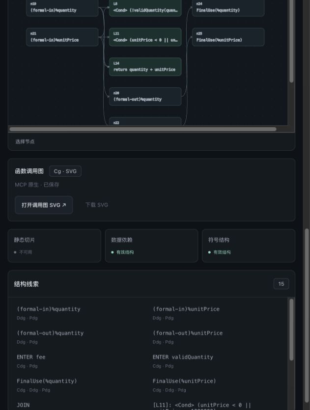
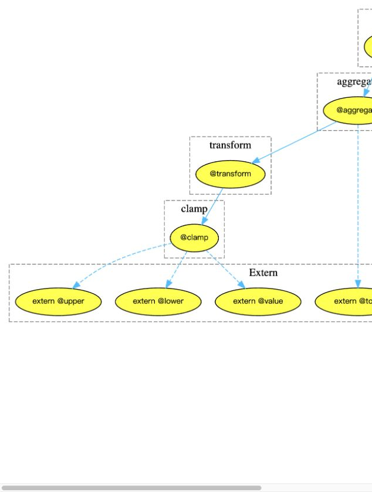

# 原生调用图 SVG 验证

日期：2026-10-21。实现范围：上传单个 .cj 文件和三个已有样例，保留原 DDG 展示，另加函数调用图 Cg 的 SVG 链接。没有增加模型调用。

## 数据来源与保存

`sympas_dep_graph` 原有 POST 同时请求 `graph_types=Ddg,Cg`、`formats=[dot,svg]`，从本次返回的 Cg graph 对象选择 SVG 链接。同源 `/artifacts/<目录>/<文件>.svg` 才能下载，不跟随重定向、不自动重试。POST 总期限45秒，SVG GET 独立期限8秒，分别最多2MiB。

授权查询参数仅用于服务端当次 GET；绝对、根相对和普通相对 artifact URL 的查询参数均在保存工具响应前脱敏。SVG 按实际返回字节保存，绑定源码 SHA-256、analysis_id、图工具原始证据 SHA-256，以及 SVG 自身摘要。详情读取和下载均核对绑定，文件变化或缺失会拒绝交付。

浏览器打开本地会话或任务/候选绑定的地址，不直接访问上游授权 URL。SVG 作为独立文档返回并设置 CSP sandbox、default-src none、nosniff 和 no-referrer；不注入页面 DOM。证据 ZIP、修复证据、影响对比证据包含原 SVG。旧快照原文件不变，页面提示重新分析。

## 真实 MCP 与浏览器验证

| 来源 | 分析标识 | SVG 字节数 | 结果 |
| --- | --- | ---: | --- |
| 本地跨函数样例 l3_calls.cj | f5dcd1727ab2433ab7e231b959660079 | 6789 | SVG 已保存；DDG、符号有效；静态切片不可用 |
| 上传 examples/upload_order_functions.cj | fa5c72a3d6ba4c959b2aed2fd6ae403d | 2711 | SVG 已保存；DDG、符号有效；静态切片不可用 |

本次两次扫描都是部分结果，没有将静态切片标记成功。SVG 是独立可用的上游产物；它的存在不代表修复正确或完整覆盖程序语义。

本地样例 SVG SHA-256：`e17ad92c77430ff41adf7fdc10aee815c3919ad243b0be5e1f0b48f94e0c30df`。

上传 SVG SHA-256：`06b65b43472746599311f7b8568badfe985a3ba92405dd1a73c68b14503a32df`。

浏览器实际打开两份 SVG，跨函数图显示 main、aggregate、transform、clamp；上传图显示 fee 调用 validQuantity。已下载样例 SVG 并与保存字节逐一比较；上传证据 ZIP 内 SVG 与本地保存文件完全一致，所有 manifest 摘要核对通过。选择新上传文件时，旧 SVG 链接消失。

实测发现上游 `download=1` 普通参数曾被误当作凭据检查，已修正并添加回归。独立审查发现普通相对 URL 查询脱敏与非法 SVG URL/XML 编码的降级问题，已修复并添加回归。

## 自动验证

测试覆盖：同源和路径约束、相对 URL 脱敏、下载参数、重定向/错误/超限/超时/无效 XML 降级、源码及原始响应绑定、文件篡改/缺失拒绝、会话隔离、CSP、ZIP 摘要、修复/影响对比证据与链接、部分结果可用以及切换文件清除链接。

- `python3 -m pytest tests -m 'not live' -q --tb=short`：360 passed，1 deselected（live 测试单独排除；本节另有真实 MCP 浏览器验证）。
- `node --test tests/*.test.cjs`：62 passed，0 failed。
- [最终 Python 原始输出](validation/callgraph-svg-python.txt)、[最终 Node 原始输出](validation/callgraph-svg-node.txt)。

已完成独立只读审查，发现的问题及修复均有回归用例。修复/影响对比的 SVG 归档与绑定入口使用测试传输验证；本次未为它们额外触发付费模型修复。
